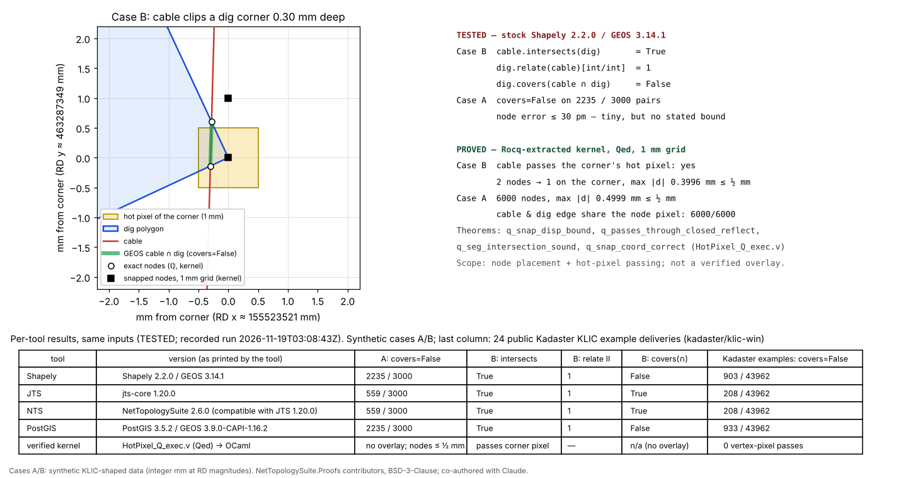

# KLIC hot-pixel demo

Stock geometry libraries answer "does this cable cross the dig area?" in ways
that contradict each other, near a dig-polygon corner, and they give no error
bound. This demo sets that next to a small verified kernel. The kernel places
nodes on a 1 mm grid with a **proved** bound of ½ mm per coordinate, and it
decides hot-pixel passing exactly.

The point is not that GEOS is badly wrong. Its intersection points are off by
about 30 **picometres**. The point is that it **contradicts itself** and
**states no bound**.



## What is proved and what is tested

| | meaning | where |
|---|---|---|
| **Proved** | Qed in Rocq, no `Admitted` in the chain, `Print Assumptions` lists only the four standard classical axioms | `theories-flocq/HotPixel_Q_exec.v`, `proof_audit/print_assumptions.txt` |
| **Proved per answer** | an output of the extracted kernel; each answer means what its reflection theorem says | `ocaml/hotpixel_q.ml` (extracted), called by `verified_hotpixel.py` |
| **Tested** | something observed by running a tool, with the tool version printed beside it | `demo.py` output, `results/*.json`, `tests/` |

### Scope

This is about **node placement and hot-pixel passing**. It is **not** a
verified overlay. No theorem here says anything about the topology of an
intersection, a union or a `covers()` answer. "The kernel gives one answer"
means one node position with a stated bound. It does not mean a verified
replacement for `ST_Intersection`.

## The bound, and the theorem that links runtime output to it

The demo calls OCaml code that Rocq extracted, **with no extraction
overrides**. `Z`, `positive` and `Q` extract as the Stdlib inductive types, so
there is no native-integer or float shim. The only hand-written OCaml is
`ocaml/main.ml`. It converts decimal digits to and from extracted `Z`, using
the extracted `Z.add`, `Z.mul` and `Z.div_eucl`.

All theorems below are in `theories-flocq/HotPixel_Q_exec.v`. All are Qed.

| runtime call | theorem | statement |
|---|---|---|
| `SNAP x s` → snapped value | `q_snap_coord_correct` | `Q2R (q_snap_coord x s) = snap_round_coord (Q2R x) (Q2R s)`: round half to even onto the grid of spacing `1/s` |
| `SNAP x s` → displacement | **`q_snap_disp_bound`** | `0 < Q2R s → Q2R (q_snap_disp x s) ≤ / (2 · Q2R s)`. On the 1 mm grid this is **≤ ½ mm per coordinate** |
| `PASS P0 P1 C s` | `q_passes_through_closed_reflect` | `q_passes_through_closed P0 P1 C s = true ↔ passes_through_hot_pixel_closed (QP2P P0) (QP2P P1) (QP2P C) (Q2R s)` |
| `TOUCH P0 P1 C s` | `q_touches_closed_reflect` | `… = true ↔ segment_touches_hot_pixel_closed …` |
| `INTER a b c d` | `q_seg_intersection_sound` | `Some X` → there are `t, u ∈ [0,1]` such that `X` is point `t` of segment `ab` and point `u` of segment `cd` |
| (inside `SNAP`) | `q_round_ne_correct` | `q_round_ne q = round_mode mode_NE (Q2R q)` (Flocq's round half to even) |

Read in sequence, the runtime reply `SNAP x 1 → (n, d)` means: `n` is
`snap_round_coord x 1`, and `d = |n − x| ≤ ½` is a theorem, not a
measurement. The test suite checks the bound on every printed value as well,
but the bound does not depend on those checks.

`snap_round_coord`, `snap_round`, `passes_through_hot_pixel_closed` and
`segment_touches_hot_pixel_closed` are the existing specifications in
`HotPixel_b64.v` and `HotPixel_b64_refs.v`. The binary64 theorems used by the
first build are still there, and the new module is tied to them:

- `b64_passes_through_implies_q`: whenever the Qed-sound binary64 filter
  `b64_passes_through_hot_pixel` fires, the Q kernel fires on the same real
  coordinates. It uses `b64_passes_through_sound` and
  `b64_liang_barsky_sound_closed`.
- `b64_snap_coord_Q_agree`: the binary64 unit-grid snap and the Q snap agree.
  It uses `b64_snap_coord_B2R`.
- `snap_round_coord_tolerance_scale` is the any-scale form of
  `snap_round_x_tol` and `snap_round_y_tol` in `NodingSeparation_b64.v`.

### Unit scale and RD magnitudes (gap 3)

- The scale `s` is an argument of every theorem above. A grid of 1 mm on
  metre input is `s = 1000`, and a grid of 1 mm on millimetre input is
  `s = 1`. The metre-to-millimetre step is therefore inside the proof. The
  test `test_metres_at_scale_1000_match_millimetres` shows both give the same
  nodes, exactly scaled by 1/1000.
- The arithmetic is exact rational arithmetic, so it has **no range limit**.
  The rounded binary64 compute filter is proved exact only on `|n| ≤ 2^22`
  (`PassesThrough_b64_grid_exact.v`). RD millimetres (about 1.5e8 to 6.3e8)
  are far outside that range, which is why the demo does not use it.
- `rd_mm_grid_representable_b64` (Qed): every integer millimetre with
  `|n| ≤ 10^9` is exactly a binary64 value. A node snapped to the 1 mm grid
  and written in millimetres therefore survives a round trip through a double.
- The same node written in **metres** is usually *not* a binary64 value. For
  example, `155523.521` is off by 7.9 pm as a double (tested,
  `test_metre_text_is_not_a_double`). So the loader reads metres from the
  GML **text** as exact decimals and never goes through float.
  `SnapRoundingScale_b64.v`'s `snap_round_preserves_passes_through_scale`
  covers the general-scale snap structure on the real side. Its binary64
  bridge needs a power-of-two scale, which 1000 is not.

## Results

### Per-tool table (tested; every row is from a run with the version printed)

Cases A and B use **synthetic** KLIC-shaped data: `make_data.py`, integer
millimetres at RD magnitudes. Case A uses 3000 random (dig polygon, cable)
pairs, and the check is `dig.covers(cable ∩ dig)`. In case B a cable clips a
dig-polygon corner 0.296 mm deep, and the checks are `intersects`, `relate`
and `covers(cable ∩ dig)`. The last column comes from the 24 public Kadaster
example deliveries, described below.

| tool (version as printed) | A: covers=False | B: intersects | B: relate II | B: covers(∩) | Kadaster examples: covers=False |
|---|---|---|---|---|---|
| Shapely 2.2.0 / GEOS 3.14.1 | 2235 / 3000 | True | 1 | **False** | 903 / 43962 |
| jts-core 1.20.0 (Java 21) | 559 / 3000 | True | 1 | True | 208 / 43962 |
| NetTopologySuite 2.6.0 (.NET 8) | 559 / 3000 | True | 1 | True | 208 / 43962 |
| PostGIS 3.5.2 / GEOS 3.9.0 (PostgreSQL 17.5) | 2235 / 3000 | True | 1 | **False** | 933 / 43962 |
| verified kernel (this repo) | no overlay; nodes ≤ ½ mm | passes corner pixel | — | n/a (not an overlay) | 0 dig-vertex pixel passes |

Recorded run: `results/stock_results.json` and
`results/stock_results_kadaster_examples.json`. Re-run with
`python stock/run_all.py`.

- **GEOS (3.14.1 via Shapely and 3.9.0 via PostGIS)** reproduces both cases.
  In case B, `intersects` says True and `relate` says the cable runs through
  the interior (`1F20F1102`). Yet `dig.covers(cable ∩ dig)` is False for the
  0.741 mm piece GEOS itself returned. Those three answers cannot all be
  right.
- **JTS and NTS** are **consistent on case B**: `covers` is True. They still
  reproduce case A on fewer pairs (559 of 3000) and on the real data (208 of
  43962). Both tools return the same intersection coordinates as GEOS, so the
  difference is in the `covers` predicate.
- PostGIS returned an empty `ST_Intersection` for 30 of the 43962 real pairs.
  Those pairs were chosen because GEOS 3.14 `intersects` was True. PostGIS's
  own `ST_Intersects` was not run on them, so this is a cross-tool
  observation, not a demonstrated self-contradiction.
- GEOS's intersection points are within **29.8 pm** of the exact rational
  node (case A, max over 6000 nodes). The error is tiny. What is missing is
  any stated bound.

### Verified side (proved per answer)

- **Case A**: 6000 exact nodes. The max snap displacement is
  57465962/114960375 mm (about 0.49988 mm), which is ≤ ½ mm. For every one of
  the 6000 nodes, both the cable and the dig edge pass through the node's hot
  pixel, so snap rounding gives both of them the same node.
- **Case B**: the cable passes through the hot pixel of corner 1 at RD
  (155523521, 463287349) mm. The two exact nodes snap to (…521, …349), which
  is the corner, and to (…521, …350), the cell above it. The max displacement
  is 4802713/12019882 mm (about 0.3996 mm), which is ≤ ½ mm.

### Real-shaped data (gap 5): public Kadaster example deliveries

Kadaster publishes example KLIC deliveries at
[`kadaster/klic-win`](https://github.com/kadaster/klic-win), in the folder
`Uitleveren/Voorbeelden IMKL v2.0`. There are 24 zips of IMKL 2.0 test
requests from 2022. That repo states **no licence**, so this repo does not
copy the data. `real_data/run_kadaster_examples.py` downloads it at pinned
commit `5e83c0e4`.

The run covered 24 deliveries and 43962 `us-net-common:UtilityLink`
centrelines, each against its `imkl:Graafpolygoon` or
`imkl:Orientatiepolygoon` (`results/kadaster_examples.json`):

- **Hot-pixel cases at dig-polygon vertices: 0** in all 24 deliveries. These
  dig polygons have vertices in whole metres, and no utility-line segment
  passes through the 1 mm hot pixel of one, except segments that end on it.
- 1879 exact line × dig-edge nodes. The max snap displacement is 0.4998 mm,
  which is ≤ ½ mm.
- **The case-A contradiction does occur on real data**: GEOS 3.14.1 gives
  `dig.covers(line ∩ dig) = False` for 903 lines, and every one of the 24
  deliveries has at least one. The other tools are in the table above.
- Not analysed: hot pixels of *other utility lines'* vertices (cable-to-cable
  noding). That is the next place to look.

### Your own (confidential) delivery

```
python tools/klic-demo/imkl_loader.py path/to/GI_gebiedsinformatielevering_XXXX_V2.xml
python tools/klic-demo/imkl_loader.py path/to/unzipped-delivery-dir --show-locations
```

Everything runs locally and nothing is uploaded. By default the report has
counts only and no coordinates. Pass `--dig-regex 'graafpolygoon|orientatiepolygoon'`
for orientation requests, and `--line-feature-regex ''` to include every line
geometry. The loader accepts `srsDimension="3"` and the three `srsName`
spellings Kadaster uses.

## Running it

```
pip install -r tools/klic-demo/requirements.txt   # pins Shapely 2.2.0 (GEOS 3.14.1)
bash tools/klic-demo/ocaml/build.sh               # stock ocamlopt; no Rocq needed
python tools/klic-demo/demo.py                     # prints every number + versions, writes the PNG
pytest tools/klic-demo                             # pins every printed number
python tools/klic-demo/stock/run_all.py            # JTS (java+mvn), NTS (dotnet), PostGIS (docker)
```

Regenerating the proof side, from the repo root, with Rocq 9.2 and Flocq 4.2.2:

```
make -f Makefile.gen theories-flocq/HotPixel_Q_exec.vo theories-flocq/NodingSeparation_b64.vo
bash tools/klic-demo/rocq/extract.sh       # rewrites ocaml/hotpixel_q.ml(i)
bash tools/klic-demo/proof_audit/audit.sh  # rewrites proof_audit/print_assumptions.txt
```

### What CI checks

- `.github/workflows/klic-demo.yml` builds the kernel and runs `demo.py` and
  `pytest`. The pinned Shapely and GEOS versions mean a GEOS fix shows up as
  a failing test with new numbers, not as a silent pass. JTS, NTS and PostGIS
  are re-run live where the runner has them. Each of those tests skips, with
  its reason, if its tool is missing.
- In `ci.yml`, the `rocq-flocq` job re-extracts against the freshly built
  corpus and fails if `hotpixel_q.ml` drifted. It also re-runs the audit
  probe and fails on any assumption beyond the four standard classical
  axioms.

## Limitations

- The data for cases A and B is synthetic. The real-data run found the
  case-A contradiction but no case-B vertex pass.
- The trusted base is Rocq's kernel, the extraction mechanism, the OCaml
  compiler, the 89-line text shim `ocaml/main.ml`, and Python's
  `Fraction(str)` decimal parsing. The bounding-box prefilter in
  `imkl_loader.py` only skips pairs that cannot touch, but it is tested, not
  proved.
- `q_seg_intersection` handles proper, non-parallel crossings. Collinear
  overlaps return `None`.
- Nothing here is a verified overlay or a verified `covers`.

## Credit

Open source, BSD-3-Clause, by the NetTopologySuite.Proofs contributors.
Co-authored with Claude.
